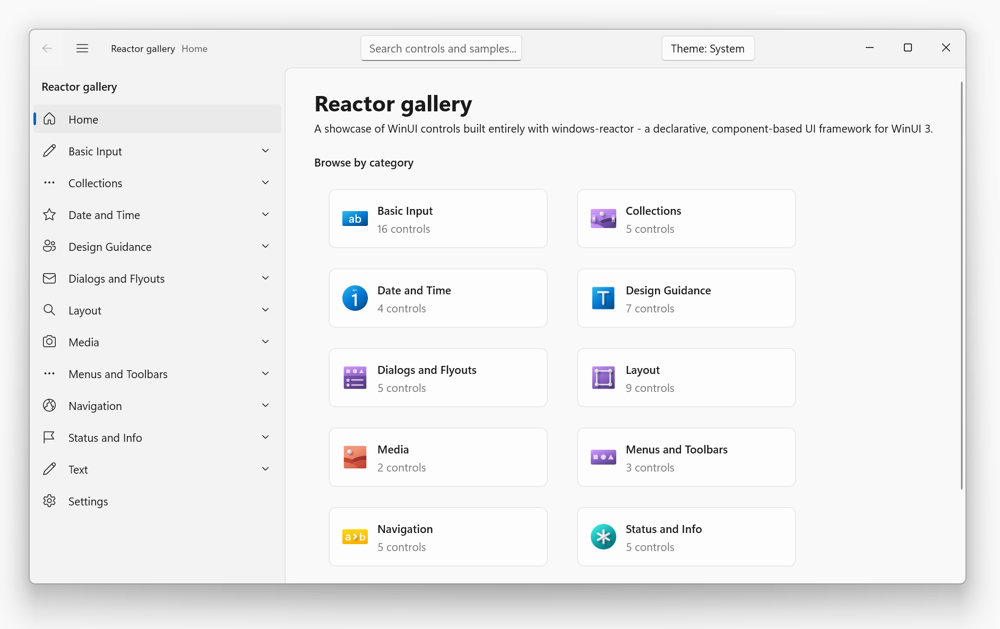

# windows-reactor

Build native WinUI 3 applications with Rust components, state, and typed messages.
Reactor is a preview; public APIs may change.

- 📦 [crates.io](https://crates.io/crates/windows-reactor)
- 📖 [docs.rs](https://docs.rs/windows-reactor)
- 🧩 [Samples](https://github.com/microsoft/windows-rs/tree/master/crates/samples/reactor)
- 📁 [Source](https://github.com/microsoft/windows-rs/tree/master/crates/libs/reactor)

## Get started

```toml
[dependencies]
windows-reactor = "0.101"
```

Apps use an installed Windows App Runtime by default; this version targets runtime 2.6.4.
To ship the runtime with your app, configure a
[self-contained build](https://docs.rs/windows-reactor-setup).

```rust,no_run
use windows_reactor::*;

#[derive(Clone, Copy)]
enum Message {
    Increment,
    Reset,
}

struct Counter {
    count: i32,
}

impl Component for Counter {
    type Input = ();
    type Message = Message;

    fn create(_input: &(), _context: &ComponentContext<Self>) -> Self {
        Self { count: 0 }
    }

    fn update(&mut self, message: Message, _context: &ComponentContext<Self>) {
        match message {
            Message::Increment => self.count += 1,
            Message::Reset => self.count = 0,
        }
    }

    fn view(&self, _input: &(), context: &mut ViewContext<Self>) -> View {
        let content = StackPanel::new().spacing(8.0).children((
            format!("Count: {}", self.count),
            Button::new()
                .on_click(context.message(Message::Increment))
                .content("Increment"),
            Button::new()
                .on_click(context.message(Message::Reset))
                .content("Reset"),
        ));
        context.window_frame("Counter", content)
    }
}

fn main() {
    App::run_component::<Counter>(()).unwrap();
}
```

Run it with `cargo run`. Updates and rendering run on the UI thread; keep `update` and `view`
quick, and use `spawn_background` for blocking work.

## Samples

Clone the repository and run the Gallery from its root to browse WinUI controls:

```sh
cargo run -p reactor-gallery
```



The [controlled input][controlled], [component input][component], and [async state][async] samples
show how to connect controls to state, split an application into components, and run background
work.

## Ship the app

Add `#![windows_subsystem = "windows"]` to hide the console window; leave it visible while
diagnosing startup. For a self-contained app, use
[windows-reactor-setup](https://docs.rs/windows-reactor-setup) from `build.rs` and distribute the
staged runtime files alongside the executable.

[controlled]: https://github.com/microsoft/windows-rs/tree/master/crates/samples/reactor/controlled
[component]: https://github.com/microsoft/windows-rs/tree/master/crates/samples/reactor/component-input
[async]: https://github.com/microsoft/windows-rs/tree/master/crates/samples/reactor/async-state
